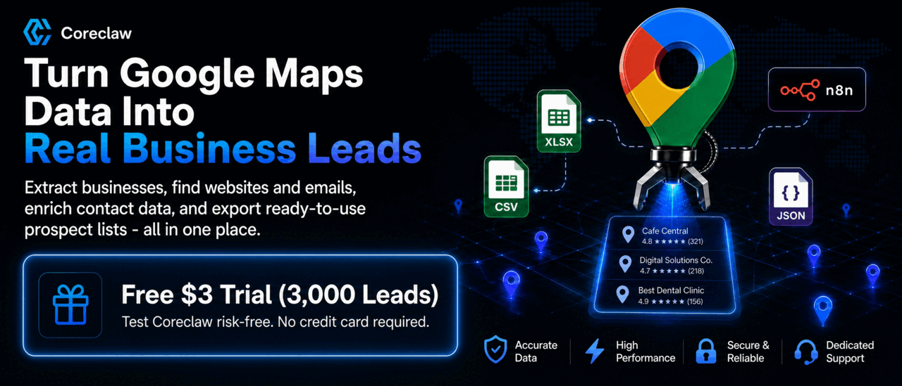
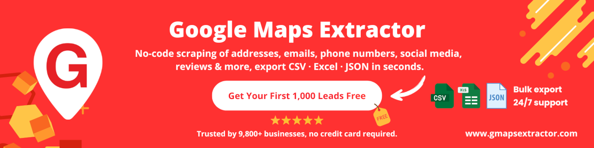
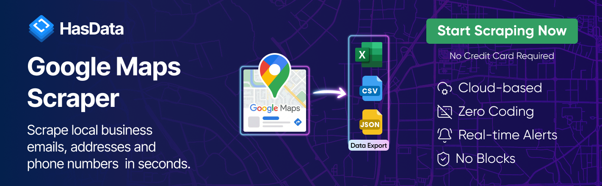
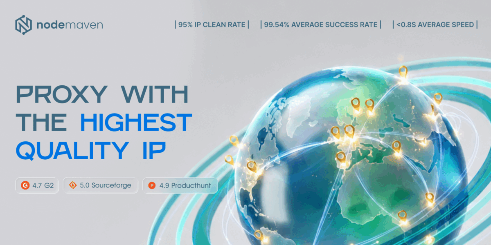
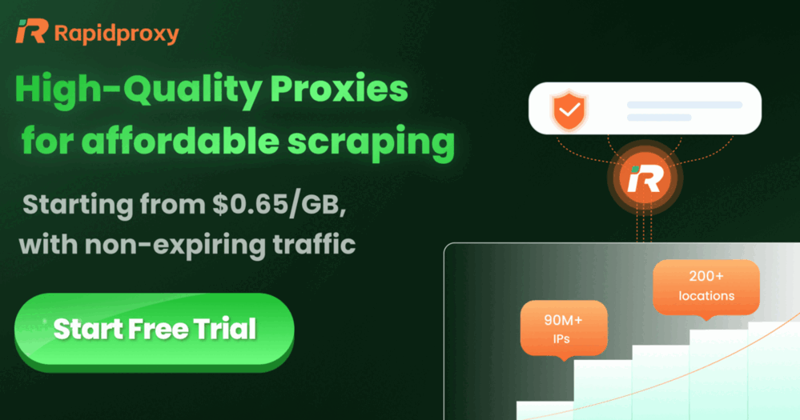
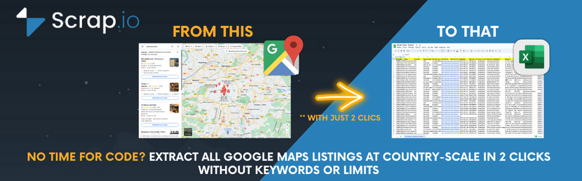
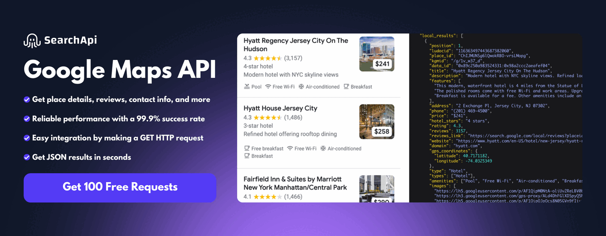
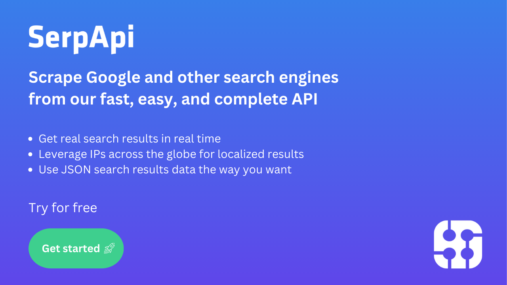
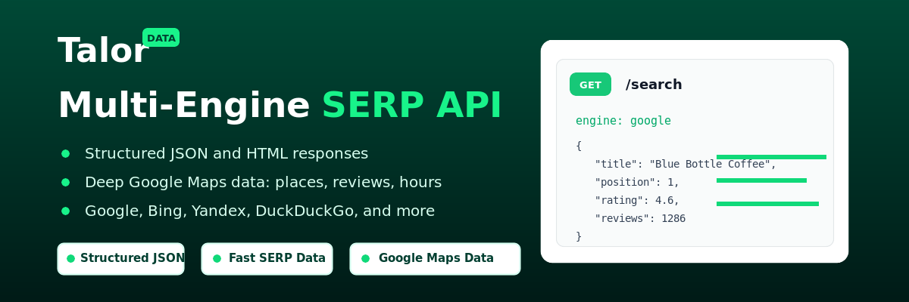
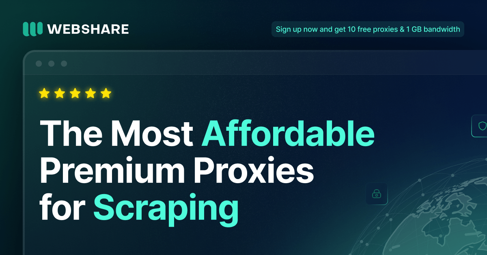

# Sponsors

These sponsors help support development and maintenance of [Google Maps Scraper](README.md).

This page collects sponsor descriptions, banners, referral links, and offers. Sponsor listings are paid placements, and some links are referral links. Sponsors are listed alphabetically.

For help configuring proxies, see [proxy setup and sponsors](docs/proxies.md).

## Sponsor Directory

- [Coreclaw](#coreclaw)
- [Evomi](#evomi)
- [G Maps Extractor](#g-maps-extractor)
- [HasData](#hasdata)
- [NodeMaven](#nodemaven)
- [RapidProxy](#rapidproxy)
- [Scrap.io](#scrapio)
- [SearchApi](#searchapi)
- [SerpApi](#serpapi)
- [TalorData](#talordata)
- [Webshare](#webshare)

---

## Coreclaw

[Visit Coreclaw](https://www.coreclaw.com/?utm_source=github&utm_medium=referral&utm_campaign=gosom&utm_term=&utm_id=gosom) — Full-stack web scraping and data extraction platform

Find ready-made workers for public websites, run them instantly, and get structured data you can export or connect anywhere. [**Get free test for $3 →**](https://www.coreclaw.com/?utm_source=github&utm_medium=referral&utm_campaign=gosom&utm_term=&utm_id=gosom)

---

## Evomi

[Visit Evomi](https://evomi.com?utm_source=github&utm_medium=banner&utm_campaign=gosom-maps) — Swiss quality proxies for scraping

Swiss quality proxies from $0.49/GB across 150+ countries, with 24/7 support and 99.9% uptime. [**Visit Evomi →**](https://evomi.com?utm_source=github&utm_medium=banner&utm_campaign=gosom-maps)

---

## G Maps Extractor

[Visit G Maps Extractor](https://gmapsextractor.com?utm_source=github&utm_medium=banner&utm_campaign=gosom) — No-code Google Maps scraper

Chrome extension that extracts emails, social profiles, phone numbers, reviews & more. [**Get 1,000 free leads →**](https://gmapsextractor.com?utm_source=github&utm_medium=banner&utm_campaign=gosom)

---

## HasData

[Visit HasData](https://hasdata.com/scrapers/google-maps?utm_source=github&utm_medium=sponsorship&utm_campaign=gosom) — No-code Google Maps Scraper & Email Extraction

Extract business leads, emails, addresses, phones, reviews and more. [**Get 1,000 free credits →**](https://hasdata.com/scrapers/google-maps?utm_source=github&utm_medium=sponsorship&utm_campaign=gosom)

---

## NodeMaven

[Visit NodeMaven](https://go.nodemaven.com/GoogleMapsScrapperoctober)

[**NodeMaven**](https://go.nodemaven.com/GoogleMapsScrapperoctober): The most efficient proxy provider for Web Scraping and Automation with the Highest Quality IP on the market.

Why [**NodeMaven**](https://go.nodemaven.com/GoogleMapsScrapperoctober)?

- ZIP targeting
- 99.9% uptime
- IP filtering: all proxies have fraud score <97%
- No KYC required
- Unique free tools: Proxy Bandwidth Checker, Meta Tag Checker, IP Lookup and others!

**Special codes for Google Maps Scraper users:**

- `MAPS2X` - 2X traffic for Black Friday
- `MAPS35` - 35% off to Mobile and Residential Proxies
- `MAPS40` - 40% off to ISP (Static) Proxies

[**Visit NodeMaven →**](https://go.nodemaven.com/GoogleMapsScrapperoctober)

---

## RapidProxy

[Visit RapidProxy](https://www.rapidproxy.io/?ref=gosom) — High-Performance Proxy Solution

Unlock global access with consistent, high-speed connections from $0.65/GB, 90M+ real residential IPs worldwide, and traffic that never expires. [**Try it free →**](https://www.rapidproxy.io/?ref=gosom)

---

## Scrap.io

[Visit Scrap.io](https://scrap.io?utm_medium=ads&utm_source=github_gosom_gmap_scraper) — Extract ALL Google Maps listings at country-scale

No keywords needed. No limits. Export millions of businesses in 2 clicks. [**Try it free →**](https://scrap.io?utm_medium=ads&utm_source=github_gosom_gmap_scraper)

---

## SearchApi

[Visit SearchApi](https://www.searchapi.io/google-maps?via=gosom&utm_source=github&utm_medium=sponsorship&utm_campaign=gosom) — Google Maps API for SERP scraping

Real-time Google Maps data with a simple integration. [**Explore the API →**](https://www.searchapi.io/google-maps?via=gosom&utm_source=github&utm_medium=sponsorship&utm_campaign=gosom)

---

## SerpApi

[Visit SerpApi](https://serpapi.com/?utm_source=google-maps-scraper) — Google Maps API and 30+ search engine APIs

Fast, reliable, and scalable. Used by Fortune 500 companies. [**View all APIs →**](https://serpapi.com/search-api)

---

## TalorData

[Visit TalorData](https://talordata.com/?campaignid=f01u8cHondg2qA47&utm_source=github&utm_term=googlemaps) — Fast SERP API for Google Maps and Search Data

Real-time SERP data APIs for Google Maps and search results, with structured JSON / HTML responses and 1,000 free API responses to start. [**Start using TalorData →**](https://talordata.com/?campaignid=f01u8cHondg2qA47&utm_source=github&utm_term=googlemaps) | [Learn more](talordata.md)

---

## Webshare

[Visit Webshare](https://www.webshare.io/?referral_code=0q3l81eet8mp) — Premium proxies for scraping at scale

The most affordable premium proxies across 195 countries & 80+ million IPs, plus a FREE plan for new users. [Learn more](webshare.md)

---

## Become a Sponsor

Help fund maintenance and new work on Google Maps Scraper. [Become a sponsor on GitHub](https://github.com/sponsors/gosom).
